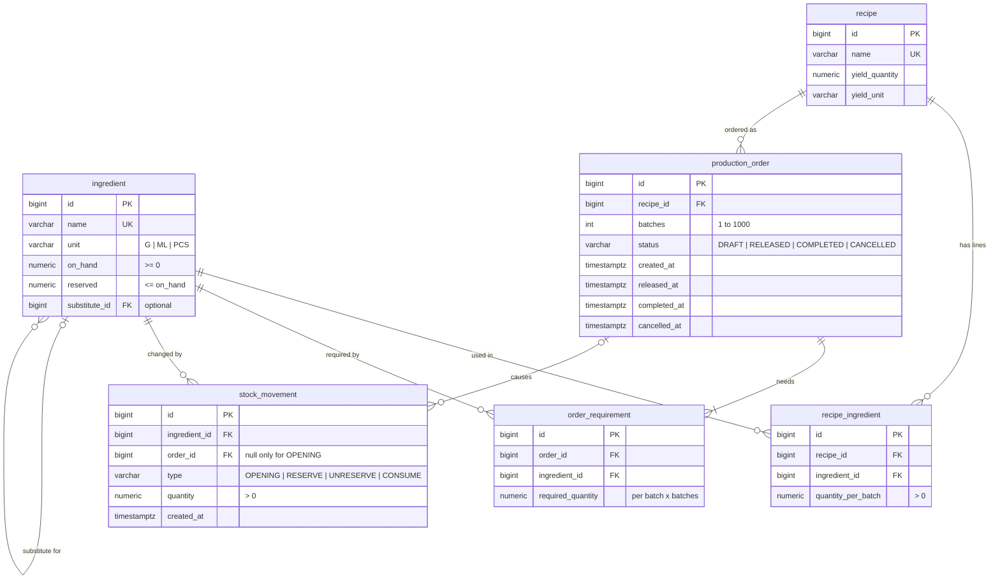

# Hearth Kitchens: Production Orders

A small app for planning production in Hearth Kitchens' central kitchen. It tracks ingredient stock, production orders for recipes, and every stock change.

- Orders move **Draft → Released → Completed**, or get **Cancelled**.
- **Releasing** an order checks stock for every ingredient. It reserves all of them, or nothing, and shows every shortage (required, available, shortfall).
- **Completing** consumes the reserved stock. **Cancelling** frees it.
- Every stock change is recorded as a **movement** linked to its order, so an ingredient's numbers can always be explained.
- **Substitutes:** if butter can't cover a requirement, margarine is used instead.

Built for the Astrobase SD1 case study. Decisions, assumptions, testing and time spent are in [BUILD_LOG.md](BUILD_LOG.md).

## Tech stack

| Part | Technology |
|---|---|
| Backend | Kotlin 1.9, Spring Boot 3.5 (Web, Data JPA, Validation), Java 21, Maven wrapper |
| Database | PostgreSQL 16, schema and seed data managed by Flyway |
| Frontend | React 19, TypeScript, Vite 7, React Router |

## Run it locally

**You need:** Java 21, Node.js 20.19 or newer, and PostgreSQL running on `localhost:5432`.

**1. Create the database (once):**

```bash
createdb -h localhost -U postgres hearth_kitchens
```

**2. Start the backend** (port 8080):

```bash
cd backend && ./mvnw spring-boot:run
```

On first start, Flyway creates the tables and loads the seed data. Wait for `Started ProductionApplicationKt`.

The connection defaults to `localhost:5432/hearth_kitchens`, user `postgres`, no password. To change it, set these environment variables before starting:

| Variable | Default |
|---|---|
| `DB_URL` | `jdbc:postgresql://localhost:5432/hearth_kitchens` |
| `DB_USERNAME` | `postgres` |
| `DB_PASSWORD` | *(empty)* |

**3. Start the frontend** (port 5173), in a second terminal:

```bash
cd frontend && npm install && npm run dev
```

Open **http://localhost:5173**. The Vite dev server forwards `/api` calls to the backend on port 8080.

**Reset to the seed data:** stop the backend, recreate the database, then start the backend again.

```bash
dropdb -h localhost -U postgres hearth_kitchens && createdb -h localhost -U postgres hearth_kitchens
```

**Troubleshooting:**
- `role "postgres" does not exist`: Homebrew PostgreSQL uses your macOS username as the default role. Run with `DB_USERNAME=$USER`.
- `Port 8080 was already in use`: another backend is running. Stop it first.
- Don't change stock directly in the database. It bypasses the movement history, and the numbers will no longer match it.

## Project structure

```
backend/
  src/main/kotlin/com/hearthkitchens/production/
    domain/        JPA entities and enums (Ingredient, Recipe, ProductionOrder, StockMovement, ...)
    repository/    Spring Data repositories, including the row-locking queries
    service/       ProductionOrderService (order lifecycle), StockService (the only code that changes stock),
                   RecipeService, read models (Views.kt), exceptions
    web/           REST controllers and the error handler
  src/main/resources/
    db/migration/  V1 schema, V2 seed data, V3 margarine substitute
    application.yml
frontend/
  src/
    api.ts         API client and types
    format.ts      units (g → kg, ml → L), labels, movement effects
    pages/         Orders, CreateOrder, Order detail, Stock, Ingredient history
docs/data-model.md UML class diagram, order lifecycle, movement types
BUILD_LOG.md       timeline, decisions, AI usage, problems, testing, unfinished work
ai-logs/           exported AI session logs
```

## Data model



| Table | What it holds |
|---|---|
| `ingredient` | Current stock: `on_hand` and `reserved`. Available = on hand − reserved, worked out rather than stored. `substitute_id` optionally names a replacement (Butter → Margarine). |
| `recipe`, `recipe_ingredient` | Each recipe's yield, and how much of each ingredient one batch needs. |
| `production_order` | An order for N batches of a recipe, its status, and when each status change happened. |
| `order_requirement` | The quantity of each ingredient the order needs (per batch × batches), saved when the order is created. |
| `stock_movement` | Append-only history: one row for every change to `on_hand` or `reserved`. |

The UML class diagram and the order lifecycle diagram are in [docs/data-model.md](docs/data-model.md).

### Why it's designed this way

- **Stock numbers are stored, and every change is also recorded as a movement in the same transaction.** Reading stock is a simple lookup. Database constraints (`reserved <= on_hand`, no negative values) reject impossible states. Replaying an ingredient's movements always gives its current numbers.
- **A movement is just a type and a quantity.** The type decides what the quantity does:

  | Type | When | On hand | Reserved |
  |---|---|---|---|
  | `OPENING` | Seed data loads opening stock | + | |
  | `RESERVE` | Order released | | + |
  | `UNRESERVE` | Released order cancelled | | − |
  | `CONSUME` | Order completed | − | − |

  `UNRESERVE` is the brief's "release" movement, renamed so it isn't confused with releasing an order.
- **Opening stock is recorded as a movement,** so the history explains the full on-hand number, not just the changes since seeding.
- **Requirements are saved on the order when it's created.** Changing a recipe later doesn't change existing orders.
- **Quantities are stored in base units** (g, ml, pcs) as exact `NUMERIC(14,3)`. Recipes in g/ml and stock in kg/L never need converting during calculations, and there's no rounding error. The UI shows kg, L and pcs.
- **Entities refer to each other by plain id columns,** not JPA relationships. There's no lazy loading or proxies, and every query is explicit. The foreign keys in the schema still enforce integrity.
- **Substitutes are data,** not hard-coded ids. An ingredient can name one substitute with the same unit, used 1:1 for the whole requirement.

### How the data stays correct

- **One transaction per action.** Create, release, complete and cancel each run in a single transaction. If anything fails partway, every change is rolled back.
- **All or nothing on release.** Every requirement is checked first. If any is short, nothing is reserved and every shortage is returned. Otherwise all are reserved. Each requirement uses its own ingredient, or its substitute if that can cover the whole amount.
- **Row locks.** Each action locks the order row, then its ingredient rows in id order (`SELECT ... FOR UPDATE`). Two requests can't overwrite each other's stock changes, and a double-clicked button can't reserve twice. The fixed lock order prevents deadlocks.
- **One place changes stock.** Only `StockService` changes stock numbers, and it always writes the matching movement in the same call.
- **What gets consumed or freed.** Complete and Cancel act on the order's `RESERVE` movements, so they consume or free exactly what was reserved, including substitutes.

## Using the app

| Screen | URL | What you can do |
|---|---|---|
| Orders | `/orders` | List orders, newest first, filtered by status (All, Draft, Released, Completed, Cancelled) |
| New order | `/orders/new` | Pick a recipe and a number of batches. Before creating, it previews each ingredient's required amount against what's available. |
| Order detail | `/orders/{id}` | See requirements and stock movements. **Release**, **Complete** or **Cancel** the order (Complete and Cancel ask for confirmation). A rejected release shows a table of shortages. |
| Stock | `/stock` | On hand, reserved, available and substitute for every ingredient |
| Ingredient history | `/stock/{id}` | Every movement, with the change it made and the balance after it, linked to its order |

**A quick walkthrough with the seed data:**
1. **New order:** Brioche loaf × 2 → **Create draft order** → **Release**. The order is Released, and 7 "Reserved" movements appear.
2. **New order:** Brioche loaf × 5 → **Release**. It's rejected with Butter short (6 kg required, 5.6 kg available) and Eggs short (90 required, 84 available). Nothing is reserved.
3. Open the first order → **Complete** → **Yes, complete**. Then open the second → **Cancel order** → **Yes, cancel order**.
4. **Stock → Butter:** opening stock 8 kg, reserved 2.4 kg, consumed 2.4 kg. On hand is now 5.6 kg.

## REST API

All endpoints are under `/api`. Quantities are in each ingredient's base unit (`G`, `ML` or `PCS`).

| Method | Path | Description |
|---|---|---|
| `GET` | `/api/ingredients` | Stock for every ingredient (on hand, reserved, available, substitute id) |
| `GET` | `/api/ingredients/{id}` | One ingredient's stock and its full movement history |
| `GET` | `/api/recipes` | Recipes with their per-batch ingredients |
| `GET` | `/api/orders?status=RELEASED` | List orders; `status` is optional |
| `POST` | `/api/orders` | Create a draft order. Body: `{"recipeId": 1, "batches": 2}`. Returns `201` and a `Location` header. |
| `GET` | `/api/orders/{id}` | The order with its requirements and movements |
| `POST` | `/api/orders/{id}/release` | Release (reserve stock) |
| `POST` | `/api/orders/{id}/complete` | Complete (consume reserved stock) |
| `POST` | `/api/orders/{id}/cancel` | Cancel (free reserved stock, if any) |

**Example** (fresh seed data). Release Brioche × 2, then try Brioche × 5:

```bash
curl -X POST localhost:8080/api/orders -H 'Content-Type: application/json' -d '{"recipeId": 1, "batches": 2}'
```

```bash
curl -X POST localhost:8080/api/orders/1/release
```

```bash
curl -X POST localhost:8080/api/orders -H 'Content-Type: application/json' -d '{"recipeId": 1, "batches": 5}'
```

```bash
curl -X POST localhost:8080/api/orders/2/release
```

**Errors** use the standard problem-details format (RFC 9457): `400` for invalid input, `404` when not found, `409` for a wrong status. The last call above is rejected for shortage, so it returns `409` and lists every short ingredient. Margarine can't cover the 6 kg of butter either:

```json
{
  "type": "about:blank",
  "title": "Insufficient stock",
  "status": 409,
  "detail": "Not enough stock to release order PO-2",
  "instance": "/api/orders/2/release",
  "shortages": [
    { "ingredientId": 3, "ingredientName": "Butter", "unit": "G",
      "required": 6000.000, "available": 5600.000, "shortfall": 400.000,
      "substituteName": "Margarine", "substituteAvailable": 5000.000 },
    { "ingredientId": 4, "ingredientName": "Eggs", "unit": "PCS",
      "required": 90.000, "available": 84.000, "shortfall": 6.000,
      "substituteName": null, "substituteAvailable": null }
  ]
}
```

## Main assumptions

All 27 decisions are in [BUILD_LOG.md](BUILD_LOG.md), section 2. The main ones:
- Batches are whole numbers from 1 to 1000.
- Draft orders can't be edited; cancel and create a new one instead.
- Cancel works on Draft or Released orders. Completed and Cancelled orders are final.
- Completing consumes exactly what was reserved. Actual usage and waste aren't recorded.
- A substitute replaces the whole requirement, 1:1, for every recipe.
- Single user, no login.

## Not done yet

There are no committed automated tests: the scenarios in the build log were run with temporary scripts. There's also no way to receive or adjust stock, no Docker setup, and no automatic restock requests. See [BUILD_LOG.md](BUILD_LOG.md), sections 7 and 8.

## AI usage

Built with Claude Code. The exported session logs are in [ai-logs/](ai-logs). What was kept, changed or rejected is recorded in [BUILD_LOG.md](BUILD_LOG.md), section 4.
