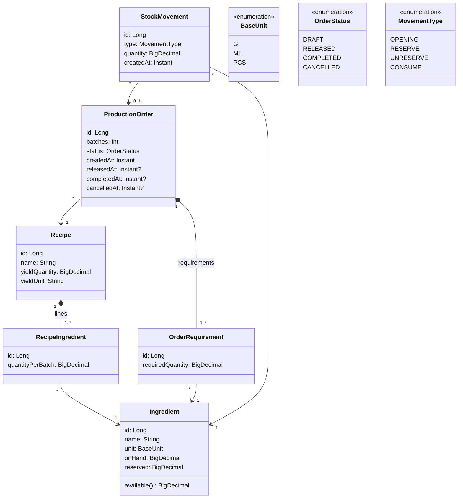
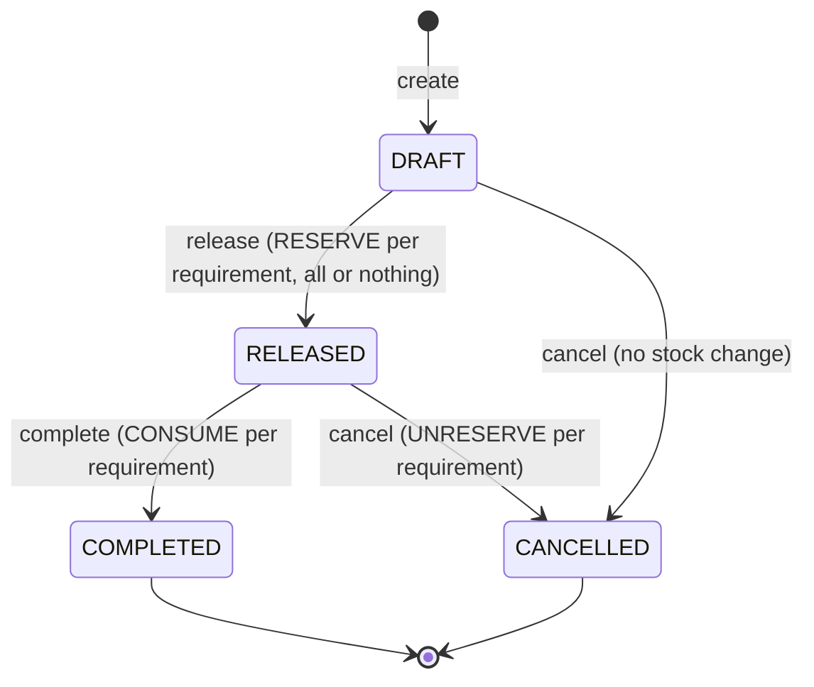

# Data model

## Entities

| Entity | Purpose |
|---|---|
| `Ingredient` | Current stock balance. `available = onHand - reserved` is computed, not stored. |
| `Recipe` | A product and its yield per batch (e.g. 12 loaves). |
| `RecipeIngredient` | How much of one ingredient one batch needs. Unique per (recipe, ingredient). |
| `ProductionOrder` | An order for N batches of a recipe, with its status and the time of each transition. |
| `OrderRequirement` | Snapshot of `quantityPerBatch × batches` per ingredient, taken when the order is created, so later recipe edits don't change existing orders. |
| `StockMovement` | Append-only history. Every change to `onHand` or `reserved` writes one row (type + quantity) in the same transaction. The type says what the quantity did to the stock. |

## Units

All quantities are stored in the ingredient's `BaseUnit` (`G`, `ML`, `PCS`) as `NUMERIC(14,3)`, so recipe quantities (g, ml) and stock (kg, L) never need converting at calculation time. The UI shows stock in kg / L / pcs, as the brief's seed table does.

## Order lifecycle

## Movement types

`quantity` is always positive; the type decides its effect.

| Type | Written when | Effect on on hand | Effect on reserved | Linked order |
|---|---|---|---|---|
| `OPENING` | Seed loads opening stock | `+quantity` | none | none |
| `RESERVE` | Order released | none | `+quantity` | required |
| `UNRESERVE` | Released order cancelled | none | `-quantity` | required |
| `CONSUME` | Order completed | `-quantity` | `-quantity` | required |

`UNRESERVE` is the brief's "release" movement, renamed so it isn't confused with releasing an order.

## Invariants (enforced by database constraints)

- `on_hand >= 0`, `reserved >= 0`, `reserved <= on_hand` on `ingredient`.
- `batches > 0`, `quantity_per_batch > 0`, `required_quantity > 0`, `quantity > 0`.
- `status` and `type` limited to their enum values.
- `stock_movement.order_id` is null only for `OPENING`.
- Applying an ingredient's movements in order, using the table above, gives its current `on_hand` and `reserved`.
